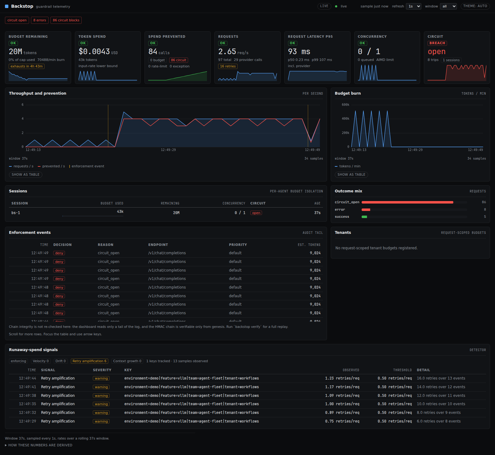

# Backstop — real-world scenarios

A runnable demo of Backstop in front of a live dashboard, in five scenarios
that each reproduce a documented production failure at the parameters that
failure actually had.

The traffic is **simulated**. The rates, the token counts and the prices are
**real** — DeepInfra's own rate card, the numbers in the incident write-ups —
so the dollars on the screen are the dollars the incident cost.

```bash
python demos/real_world/run.py --list                    # the scenarios and the endpoint matrix
python demos/real_world/run.py                          # the headline scenario
python demos/real_world/run.py --scenario agent-loop    # one scenario
python demos/real_world/run.py --all                    # all five, in order
```

The dashboard comes up on <http://127.0.0.1:8787/> and refreshes itself. The
terminal narrates what is happening while it runs.

**No API key. No network. No bill.** Every request goes to a local mock that
answers in the endpoint's own protocol and reports the usage the scenario
says it should.

---

## The five scenarios




| # | Scenario | The incident it reproduces | Kind of server | Endpoint |
|---|---|---|---|---|
| 1 | **The $10,000 Overnight** | A multi-tenant AI SaaS. One customer's agent falls into a loop and burns $10,000 overnight; the other 199 customers are fine, and they are the ones who churn. | managed inference | DeepInfra |
| 2 | **The 11-Day Ping-Pong** | Four agents in a research pipeline. Two of them lock into a recursive loop and keep it for eleven days. Every health check passes the whole time. The bill is $47,000. | the provider's own API | Anthropic |
| 3 | **The Thundering Herd** | Fifty agent workflows hit a self-hosted vLLM server that starts returning 429s. Every workflow retries with the full context, and a queue of users pressing refresh multiplies the load again. | inference servers you run | vLLM |
| 4 | **The $47,000 RAG Bot** | A RAG bot that retrieves eight 500-token chunks for every question whether the question needs them or not. | managed inference | DeepInfra |
| 5 | **The $50,000 Unattributed Bill** | Thirty-five teams against a cloud gateway, and a $50,000 a month invoice nobody can attribute to a team. | cloud gateways | Amazon Bedrock |

Each one ends with the same question answered on the terminal: *what would
this have cost with nothing in the way?*

---

## The four kinds of server

The demo covers the whole matrix, because that is the point of the product:
**the wire protocol is the integration.** There is no DeepInfra adapter and no
vLLM adapter, and the controls do not change with the provider.

| Kind | Servers | What Backstop adds |
|---|---|---|
| The provider's own API | OpenAI, Anthropic | Budgets, breaker, concurrency — and a price, from the catalogue that ships inside Backstop. |
| Inference servers you run | vLLM, SGLang, llama.cpp, Ollama, LM Studio, TGI, Docker Model Runner | The same budgets, the same breaker, the same concurrency limit. No price until you file one. |
| Managed inference | DeepInfra, Together AI, Fireworks, OpenRouter, Groq, Cerebras, Replicate, Baseten, Mistral, NVIDIA NIM | The same. No price until you file one. |
| Cloud gateways | Amazon Bedrock, Azure OpenAI, Google Vertex AI | The same. No price until you file one. |

`--list` prints the whole matrix with the base URL of every entry.

---

## How the prices work

DeepInfra's rates, from <https://deepinfra.com/pricing>, checked on
**2026-10-22**, live in `prices.json` — a **user price catalog**, the same
mechanism `docs/integrations.md` describes for a deployment that calls a host
Backstop does not recognise:

```json
{
  "model": "meta-llama/Llama-3.3-70B-Instruct-Turbo",
  "provider": "unknown",
  "input_per_mtok_usd": "0.10",
  "output_per_mtok_usd": "0.32"
}
```

The provider is `"unknown"` on purpose. Backstop derives the provider from the
host, and it refuses to invent one it does not recognise — an invented
provider produces a charge-back row that looks authoritative and is wrong.
The models are unique to the provider that serves them, so the price is filed
against the model.

The two models that also exist in the bundled catalogue
(`claude-haiku-4-5`, `gpt-5.6-luna`) are filed here because they are reached
through a gateway rather than the provider's own host, so the bundled entry
does not match and the event would otherwise be unpriced.

**The prices move.** A demo that quotes a rate from six months ago is a demo
that lies. Re-check the rate card before showing this to anyone.

---

## What the dashboard shows

Everything the demo drives is on <http://127.0.0.1:8787/>:

- **Budget remaining** — the shared pool, with its burn rate and when it runs out.
- **Token spend** — priced at the endpoint's own rate.
- **Spend prevented** — what the guardrails stopped.
- **Throughput and prevention** — requests per second, and the enforcement events marked on the line.
- **Budget burn** — tokens per minute.
- **Enforcement events** — every denial, with its reason, its endpoint and its tenant.
- **Tenants** — the per-tenant caps, and how much of each is gone.
- **Sessions** — per-agent budget isolation.
- **Runaway-spend signals** — the detector's view, in enforcing mode.

The dashboard is restarted between scenarios so the cost model is the one
belonging to the scenario on screen. The URL never changes.

---

## Running it against a real provider

`--live` points the same client at the real endpoint instead of the mock, if
that provider's key is in the environment:

```bash
export DEEPINFRA_API_KEY=...
python demos/real_world/run.py --scenario noisy-neighbour --live
```

The request bodies are then exactly what an operator would send, and the
provider's own usage is what the ledger records. The traffic shape is still
the scenario's, so this spends real money at the scenario's rate — start with
`--scenario rag-peak` and a small `--speed`.

---

## Notes on the simulation

- **The rate and the cap are scaled together.** A tenant's cap is set so the
  guardrail trips inside the demonstration window, and the banner says so.
  What is being shown is the *ratio* between the runaway rate and the cap,
  not the volume.
- **Only the failing tenant is capped.** The others spend against the shared
  pool, which is what the platform's own budget tile shows. In a real
  deployment every tier would carry its own cap.
- **The token counts are the scenario's.** The request body is as long as the
  prompt it claims to carry, so Backstop's own token estimate is the real one
  rather than a rounding of a placeholder.
- **The mock speaks the endpoint's protocol.** The OpenAI-compatible shape for
  everything but Anthropic, which gets Anthropic's own message shape, because
  the two report usage differently and the ledger has to read both.

---

## The sources

Each scenario's incident has a source, printed in the banner and in
`catalogue.py`:

1. <https://docs.portkey.ai/docs/guides/use-cases/multi-tenant-ai-feature>
2. <https://techstartups.com/2025/11/14/ai-agents-horror-stories-how-a-47000-failure-exposed-the-hype-and-hidden-risks-of-multi-agent-systems/>
3. <https://tianpan.co/blog/2026/04/10/retry-storm-problem-agentic-systems>
4. <https://compresr.ai/blog/rag-over-retrieval-token-costs-guide>
5. <https://news.ycombinator.com/item?id=44848323>

And the rate cards:

- DeepInfra — <https://deepinfra.com/pricing>
- Provider base URLs — the official documentation for each one; `--list`
  prints them.
